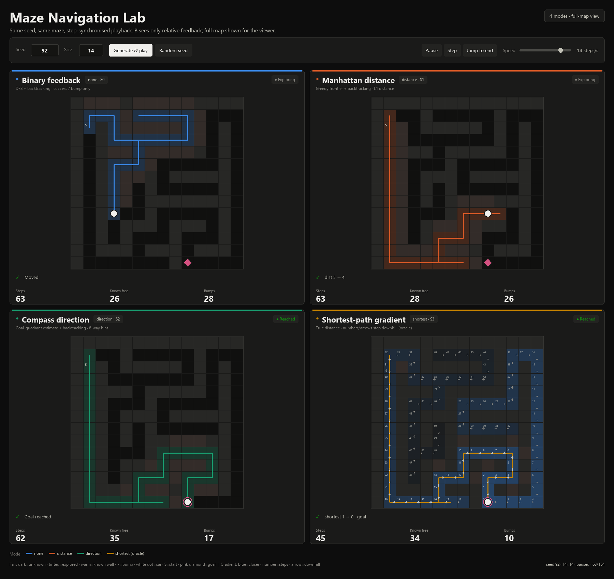
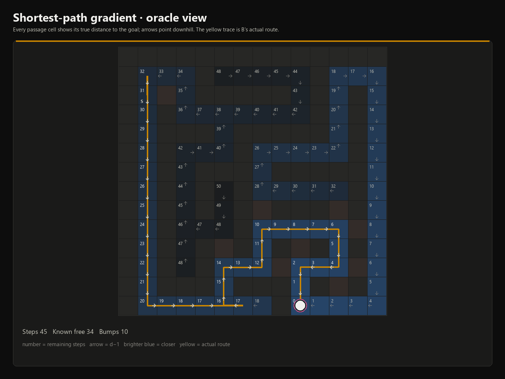

# Maze Navigation Lab

[](https://github.com/ohto-ai/maze-navigation-lab/actions/workflows/ci.yml)
[](https://www.python.org/)
[](LICENSE)

A maze-navigation playground comparing what an agent can do with different
feedback signals.

A **maze server (A)** generates a perfect maze, places a car and a goal, and
answers movement commands. A **relative-navigation agent (B)** never learns its
absolute coordinates: it builds a map from movement outcomes and limited
feedback. The project ships with three fair feedback modes, an intentionally
leaky shortest-path gradient oracle, a four-panel Tkinter dashboard, and a
100-seed benchmark.



*Dashboard preview: seed 92, 14×14 maze, frame 63. Four modes share the same
maze and playhead. The gradient panel exposes the true distance field while the
yellow line shows B's actual route.*

## Contents

- [Highlights](#highlights)
- [Quick start](#quick-start)
- [Feedback modes](#feedback-modes)
- [Architecture](#architecture)
- [Protocol](#protocol)
- [Algorithms](#algorithms)
- [Graphical dashboard](#graphical-dashboard)
- [Benchmarks](#benchmarks)
- [Project layout](#project-layout)
- [Development](#development)
- [Limitations and roadmap](#limitations-and-roadmap)
- [License](#license)

## Highlights

- Perfect mazes from a randomized recursive-backtracker; reproducible with
  `--seed`.
- A/B are separate processes communicating over a JSON-lines stdin/stdout
  protocol.
- B receives no absolute coordinates and never calls A's debug `state` command.
- Reliable transport: timeouts and malformed responses are retried, and
  request IDs make retries idempotent.
- Three fair strategies plus an explicit oracle baseline:
  DFS, Manhattan-distance frontiers, compass hints, and true shortest-path
  gradient descent.
- Side-by-side 2×2 visual comparison with synchronized playback, live
  statistics, and a cell-by-cell gradient overlay.
- 100-seed benchmarks at 10×10 and 14×14, with per-run JSON artifacts.
- Standard library only (Tkinter is used for the optional dashboard).

## Quick start

Requires Python 3.10+.

```bash
git clone https://github.com/ohto-ai/maze-navigation-lab.git
cd maze-navigation-lab

# Interactive four-panel dashboard
python gui_demo.py

# Reproduce the 10x10 benchmark (100 seeds: 100..199)
python run_experiment.py --size 10 --seed-start 100 --seeds 100

# Run one agent against one maze
python b_agent.py --mode distance --strategy auto --max-steps 10000

# Shortest-path gradient oracle
python b_agent.py --mode shortest --strategy auto --max-steps 10000
```

`gui_demo.py` defaults to seed 92 and a 14×14 maze. On minimal Linux images,
install Tk support first (`sudo apt install python3-tk`).

### Custom A instance

B starts A internally. Pass a JSON command array to launch a different A
configuration:

```bash
python b_agent.py --mode direction --strategy s2 \
  --a-command '["python","-u","a_maze.py","--size","14","--mode","direction","--seed","92"]'
```

B's navigation code treats this as an opaque launch command; it receives only
feedback over the pipe.

## Feedback modes

| Mode | Feedback field | Meaning | Agent |
|---|---|---|---|
| `none` | — | `success` / `is_goal` only | S0 |
| `distance` | `distance` | Manhattan distance to the goal | S1 |
| `direction` | `dir_hint` | Absolute 8-way goal quadrant (`N/NE/...`) | S2 |
| `shortest` | `shortest_distance` | True shortest-path length (oracle) | S3 |

The first three modes are the information-limited comparison. They never
report absolute positions, shortest-path distances, or the first move of a
shortest path.

> **Oracle warning.** `shortest` is deliberately leaky and is not a fair mode.
> It exists to measure the ceiling available when a perfect gradient is handed
> to the agent. Do not compare it directly with the three fair modes when
> discussing information-limited navigation.

A's normal responses for fair modes contain only `success`, `is_goal`, and the
single mode-specific field. The explicit `state` command is the only debug
path that exposes absolute coordinates; B does not call it.

## Architecture

```
                 {"cmd":"move","dir":"up","id":17}
┌──────────────┐ ────────────────────────────────┐
│  b_agent.py  │                                   │  a_maze.py
│  agent +     │ ←──────────────────────────────── │  perfect maze +
│  strategies  │ success / is_goal / distance /    │  movement + feedback
└──────────────┘ dir_hint / shortest_distance      └────────────
        │
        └── run_experiment.py spawns A and B for every (seed, mode)
```

`run_experiment.py` starts an independent B process per run; B launches its own
A process. `gui_demo.py` is a visualization layer that runs the same
environment and strategy classes in-process, records one snapshot per move,
and replays the snapshots in a Tkinter window. The GUI is an omniscient viewer;
the agent code still receives only relative feedback.

## Protocol

### Requests

```json
{"cmd":"move","dir":"up"}
{"cmd":"move","dir":"right","id":17}
{"cmd":"reset"}
{"cmd":"state"}
{"cmd":"quit"}
```

- `id` is optional. If supplied, A echoes it and caches the response (last 1024
  IDs), making a retry idempotent.
- `reset` returns the car to the start and resets the step counter.
- `state` returns a debug snapshot (`maze`, `car_pos`, `goal_pos`, ...). Agent B
  must not use it.
- `quit` lets A exit cleanly.

### Responses

Fair distance mode:

```json
{"success":true,"is_goal":false,"distance":7}
```

Shortest oracle mode:

```json
{"success":true,"is_goal":false,"shortest_distance":7}
```

Direction mode replaces the distance field with `dir_hint`; a failed move still
returns the car's current observation. At the goal, the distance is `0` and
`dir_hint` is `null`.

### Failure handling

A timeout, pipe failure, malformed JSON, invalid fields, or an `error` response
is **not** a wall. B retries the same logical request with the same ID. Only a
valid response updates the relative map. This is why a dropped response cannot
silently move the car twice or corrupt the map.

## Algorithms

### S0 — binary DFS (`none`)

Depth-first search over unknown relative neighbours in a fixed order. Successful
moves are pushed; dead ends backtrack. A perfect connected maze guarantees
reaching the goal.

### S1 — Manhattan frontier (`distance`)

At start, B calibrates the start distance with a wall probe or a short
move-and-return. Frontier cells are known-free cells with unknown neighbours.
B ranks them by observed Manhattan distance plus known-map travel cost, walks
the known route, and probes. Manhattan distance has wall-induced local minima,
so detours and backtracking remain necessary; S1 still explores far less than
S0 on average.

### S2 — compass frontier (`direction`)

Each hint is a sign constraint on the relative goal position (`NE` means the
goal is north-east, cardinal hints pin one axis). B intersects observed
constraints into a relative goal estimate and ranks frontiers by distance to
that estimate. Unknown directions are ordered by the estimate and the current
hint.

### S3 — shortest-path gradient (`shortest`, oracle)

At a cell with true distance `d`, a neighbour is on the unique goal path iff it
has distance `d-1`; neighbours at `d+1` point away. B walks to known `d-1`
neighbours and probes unknown directions one at a time. A wrong free branch is
entered once and immediately undone; walls are remembered. This reaches the
goal without exploring the whole maze, but still pays for wall probes and
one-step mistakes because directions are not disclosed.

## Graphical dashboard

```bash
python gui_demo.py
python gui_demo.py --seed 92 --size 14 --speed 14
python gui_demo.py --paused
```

The window is a 2×2 grid showing all four modes at once on the same maze,
synchronized by step index:

- each card reports steps, known free cells, wall bumps, and the last feedback;
- the car is a white dot; the start is `S`; the goal is a pink diamond;
- red `×` marks the most recent wall bump;
- a mode-coloured line shows the actual trajectory;
- the shortest-path card adds a **gradient overlay**:
  - every passage cell shows its true number of remaining steps;
  - arrows point toward the `d-1` neighbour;
  - brighter blue means closer to the goal;
  - brighter numbers/arrows indicate cells B has already observed;
  - the yellow line is still B's actual walked route, including detours.

<p align="center">
  <a href="docs/gradient-detail.png">
    
  </a>
</p>

*Close-up of the oracle gradient view. Numbers are true distances; arrows point
downhill; the yellow route shows where B actually probed and backtracked.*

Controls: seed, size, generate/play, random seed, pause, single-step, jump to
end, and a 1–30 steps/s speed slider. Changing the seed or size rebuilds all
four traces on the same new maze.

## Benchmarks

**Setup.** 100 consecutive mazes per size (`seed 100..199`), with the same
maze/start/goal shared across all four modes. Steps include successful moves,
wall probes, and backtracking. Communication retries that did not execute a
move are not counted. Means are over all runs; all runs reached the goal.

### 10×10

| Mode | Strategy | Reached | Mean steps | Median steps | Mean explored cells |
|---|---|---:|---:|---:|---:|
| `none` | S0 | 100/100 | 61.72 | 52.0 | 25.26 |
| `distance` | S1 | 100/100 | 52.74 | 40.0 | 19.37 |
| `direction` | S2 | 100/100 | 53.10 | 37.5 | 20.73 |
| `shortest` (oracle) | S3 | 100/100 | 22.33 | 20.0 | 15.54 |

### 14×14

| Mode | Strategy | Reached | Mean steps | Median steps | Mean explored cells |
|---|---|---:|---:|---:|---:|
| `none` | S0 | 100/100 | 118.59 | 111.0 | 47.26 |
| `distance` | S1 | 100/100 | 105.77 | 88.5 | 35.88 |
| `direction` | S2 | 100/100 | 100.40 | 64.0 | 37.01 |
| `shortest` (oracle) | S3 | 100/100 | 37.68 | 32.5 | 26.50 |

Raw per-seed data:
[10×10](results/benchmark_10x10.json) ·
[14×14](results/benchmark_14x14.json).

**Reading the numbers.**

- On 10×10, distance feedback lowers mean steps by 14.6% and direction feedback
  by 14.0% versus binary DFS. Median steps drop 23.1% and 27.9% respectively,
  which reflects fewer heavy-tail outliers.
- On 14×14, the mean gains are 10.8% (distance) and 15.4% (direction); median
  gains are 20.3% and 42.3%. The heuristic advantage becomes less uniform as
  branching and backtracking distances grow.
- The leaky oracle cuts mean steps by 63.8% on 10×10 and 68.2% on 14×14 versus
  binary DFS. It is still not equal to the true shortest path because B must
  discover which direction is downhill by probing.
- Every strategy reached the goal in all 800 benchmark runs across both sizes. The oracle is
  included to show the gradient ceiling, not to claim a fair comparison.

## Project layout

```
.
├── a_maze.py                  # maze environment, feedback, JSON-line server
├── b_agent.py                 # transport, relative map, S0–S3
├── gui_demo.py                # 2×2 Tkinter dashboard
├── run_experiment.py          # parallel-free batch runner and summaries
├── results/
│   ├── benchmark_10x10.json
│   └── benchmark_14x14.json
├── docs/
│   ├── preview.png            # dashboard preview
│   └── gradient-detail.png    # gradient close-up
├── tests/
│   └── test_maze_navigation.py
├── .github/workflows/ci.yml
├── LICENSE
└── README.md
```

## Development

The runtime has no third-party dependencies. Run the test suite with:

```bash
python -m unittest discover -s tests -v
```

Tests cover perfect-maze invariants, reproducible layouts, feedback contracts,
request-ID idempotency, gradient-strategy reachability, all four end-to-end
agent modes, and the GUI trace builder. The Tkinter test is skipped on systems
without Tk.

CI runs the suite on Ubuntu and Windows for Python 3.10 and 3.13.

Useful commands:

```bash
python run_experiment.py --size 10 --seed-start 100 --seeds 100 \
  --modes none,distance,direction,shortest \
  --output results/benchmark_10x10.json

python run_experiment.py --size 14 --seed-start 100 --seeds 100 \
  --output results/benchmark_14x14.json
```

`--visualize-seed N --modes distance` prints A's full maze and B's relative map
to stderr for a single run.

## Limitations and roadmap

- Movement is deterministic: no slip, teleport, dynamic obstacles, or partial
  observability beyond the relative map.
- The fair-distance and compass heuristics still suffer from local minima and
  occasional long detours; large-maze performance has high variance.
- The oracle gradient is intentionally leaky. It is useful as a ceiling, not as
  a deployable sensor model.
- Planned extensions: richer observability models, weighted/noisy movement,
  HTTP transport, and a larger stress benchmark.

## License

MIT © 2026 [ohto-ai](https://github.com/ohto-ai).
